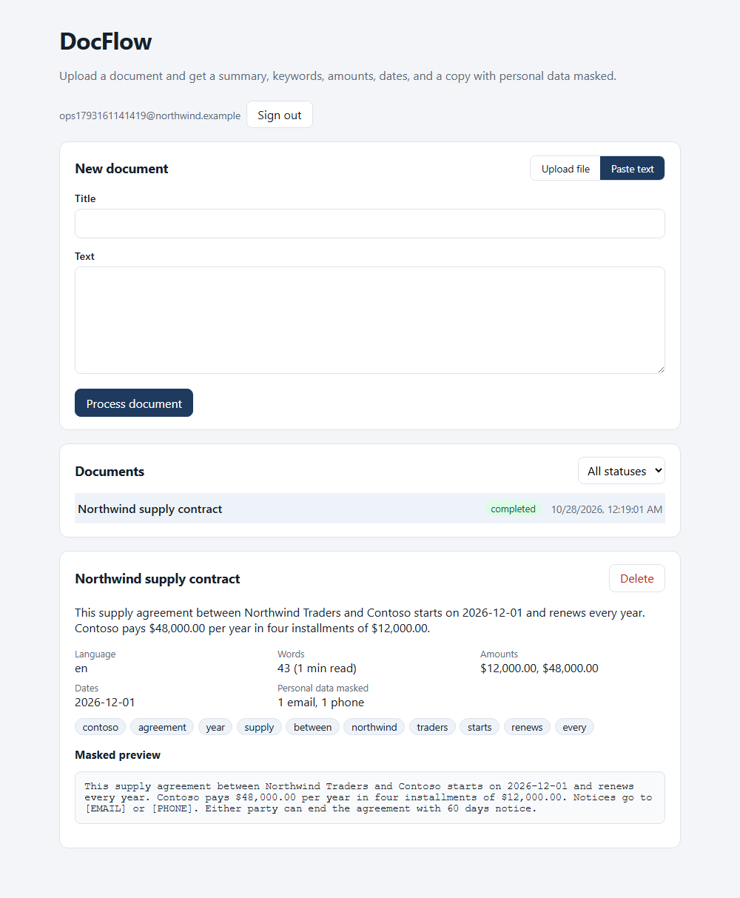

# DocFlow

Document intake service. Upload a PDF or a text file, or paste text, and DocFlow returns a short summary, keywords, language, money amounts, dates, and a copy with emails, phone numbers, card numbers, and IBANs masked. Nothing leaves your servers: extraction runs locally, with no external AI service.

License: Apache-2.0. Keep `LICENSE` and `NOTICE` if you fork it.
Author: Daniel Llano ([github.com/daniel-llano](https://github.com/daniel-llano))



## How it fits together

```
browser ── Next.js web app ──/api──▶ FastAPI ──▶ PostgreSQL
                                        │
                                        └─▶ Redis queue ──▶ worker ──▶ FastAPI /internal
                                                                          │
                                                       signed webhook ◀───┘──▶ NestJS receiver
```

- The web app proxies `/api` to FastAPI, so the browser never talks to the API directly and no CORS setup is needed.
- A job is queued in Redis. The worker moves it to a processing list while it works, so a crash puts it back instead of losing it.
- Failed attempts are retried up to `MAX_ATTEMPTS` times, then the job is marked failed and can be retried from the UI.
- When a job finishes, the API posts a webhook signed with HMAC-SHA256 (`X-DocFlow-Signature`). The NestJS receiver rejects anything unsigned.
- Without `REDIS_URL`, the API processes jobs itself in the background. That's handy for tests and single-box installs.

## Layout

```
docflow/
├── services/api      FastAPI, SQLAlchemy, Alembic migrations, worker, pytest suite
├── services/notify   NestJS webhook receiver
├── apps/web          Next.js 16 (App Router) + React 19
├── infra/            docker-compose for the whole stack
└── e2e/              Playwright tests
```

## Run it

```bash
./scripts/run.sh        # or .\scripts\run.ps1
```

| What | Where |
|------|-------|
| Web app | http://localhost:3006 |
| API | http://localhost:8086 (interactive docs at `/docs` when `APP_ENV` isn't production) |
| Webhook receiver | http://localhost:8090/events |

Create an account on the home page. There's no default user. Set `BOOTSTRAP_EMAIL` and `BOOTSTRAP_PASSWORD` if you want one created on startup.

Without Docker:

```bash
cd services/api && pip install -r requirements-dev.txt && uvicorn app.main:app --port 8086
cd apps/web && npm install && npm run dev
```

That uses SQLite and in-process jobs. Copy `.env-sample` to `services/api/.env` to change settings.

## API

| Method | Path | Notes |
|--------|------|-------|
| POST | `/api/auth/register`, `/api/auth/login` | Returns a bearer token |
| GET | `/api/auth/me` | |
| POST | `/api/jobs` | `{ title, text }` |
| POST | `/api/jobs/upload` | Multipart `file` (.pdf, .txt, .md, .csv, .log) and optional `title` |
| GET | `/api/jobs?status=&limit=&offset=` | Your jobs, newest first |
| GET, DELETE | `/api/jobs/{id}` | |
| POST | `/api/jobs/{id}/retry` | Failed jobs only |
| GET | `/health/live`, `/health/ready` | Ready checks the database and the queue |

## Configuration

| Variable | Notes |
|----------|-------|
| `APP_ENV` | `production` turns off `/docs` and refuses to start with the local secrets |
| `DATABASE_URL` | `postgresql+psycopg://...` in production. Run `alembic upgrade head` before starting |
| `REDIS_URL` | Enables the queue and the separate worker |
| `JWT_SECRET`, `JWT_MINUTES` | Signing key (32+ characters) and token lifetime |
| `INTERNAL_KEY` | Shared by the API and the worker for `/internal` calls |
| `WEBHOOK_URL`, `WEBHOOK_SECRET` | Where to post job events and the HMAC key |
| `MAX_ATTEMPTS`, `MAX_UPLOAD_MB` | Default 3 and 5 |
| `API_INTERNAL_URL` | Web app build arg: where the Next.js server forwards `/api` |

Scanned PDFs have no text layer, so they need OCR before upload.

## Tests

```bash
./scripts/test.sh   # pytest, webhook receiver tests, web typecheck + Vitest + build
./scripts/e2e.sh    # Docker stack + Playwright
```

See [TESTING.md](TESTING.md).
